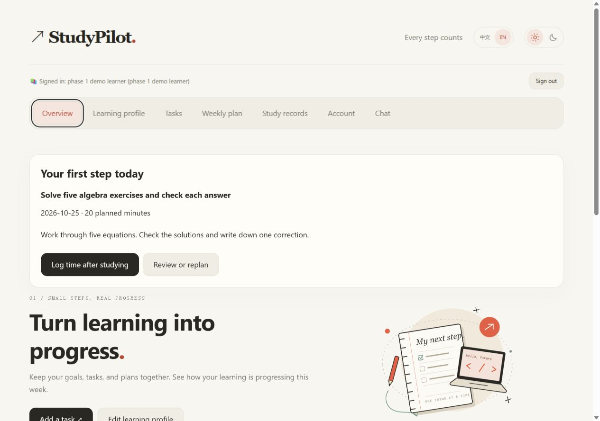
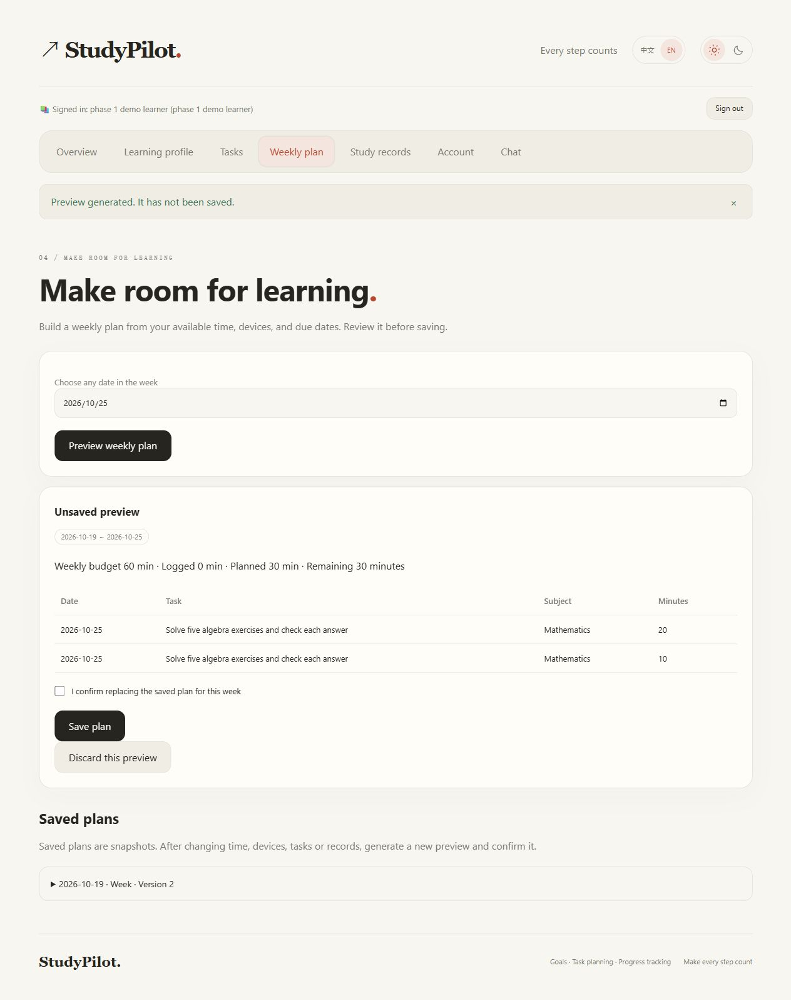

<div align="center">

# StudyPilot

### Turn learning into progress.

A personal learning workspace for clear goals, practical weekly plans, and progress grounded in real study time.

[Open StudyPilot](https://study-pilot-olive.vercel.app/) · [Features](#what-you-can-do) · [Run locally](#run-the-web-app-locally) · [Deployment](python-ai-agent-ai-agent-studypilot/outputs/StudyPilot/DEPLOYMENT.md) · [MIT License](python-ai-agent-ai-agent-studypilot/outputs/StudyPilot/LICENSE)

</div>

---

## Open StudyPilot

### Use the website — no installation

**[https://study-pilot-olive.vercel.app/](https://study-pilot-olive.vercel.app/)**

Open the link in your browser, create an account, and start learning. The website supports English and Simplified Chinese.

### Download for Windows

**[Download StudyPilot for Windows (.zip)](https://github.com/aerixx0/Study_Pilot/releases/download/v0.6.0-preview.1/StudyPilot-Windows-v0.6.0-preview.1.zip)**

1. Install **Python 3.12 or later** from [python.org](https://www.python.org/downloads/windows/). With the classic installer, enable **Add python.exe to PATH**.
2. Download the ZIP above, right-click it, choose **Extract All**, and open the extracted `StudyPilot-Windows` folder.
3. Double-click **`Start-StudyPilot.cmd`**. On first launch, keep the window open while dependencies download. The local app then opens in your browser at **[http://127.0.0.1:8501/](http://127.0.0.1:8501/)**.

This download runs locally in your browser and requires Python and an internet connection for initial setup. It is **not a standalone `.exe` installer**. Its Streamlit interface is currently Chinese; use the website for English. Local and website accounts are separate.

[Windows instructions and troubleshooting](Usage.md) · [Release notes](https://github.com/aerixx0/Study_Pilot/releases/tag/v0.6.0-preview.1)

## What is StudyPilot?

StudyPilot brings the personal learning cycle into one place: decide what matters, turn it into tasks, make room for those tasks in your week, and record what you actually did.

It combines structured learning management with an optional AI conversation workspace. Manage your learning without AI, or use Chat to discuss goals, understand progress, and review suggested changes. Your saved goals and tasks remain under your control.

The Web app supports **English and Simplified Chinese**, light and dark themes, desktop and mobile layouts, and a dedicated chat workspace with animated sidebar navigation. Use the hosted website, deploy your own instance, or run locally with persistent storage.

## Who it is for

- **Independent learners** working through courses, books, and practical projects.
- **Students preparing for exams** who need to balance priorities, due dates, and limited time.
- **People learning alongside work** who want plans that reflect their actual availability and devices.
- **Developers and self-hosters** who want an inspectable application with local or PostgreSQL-backed storage.

## Implementation status

This table describes the current source. Check the [Phase 1 report](docs/PHASE1_REPORT.md) for validation and deployment status. The Windows ZIP linked above is the frozen `v0.6.0-preview.1` release; it does not automatically receive subsequent source changes.

| Capability | Status |
| --- | --- |
| Accounts, isolated learning data, task editing, actual records and export | Implemented |
| Day/week/session budgets, task deadlines and computer constraints | Implemented in the rule-based scheduler |
| Optional overall goal deadline and rule-derived conflict adjustments | Implemented in current source |
| First-use checklist, confirmed-plan next action, discardable previews | Implemented in current Web source |
| AI read tools, previewed proposals, explicit confirmation and atomic execution receipts | Implemented; real model availability depends on configured providers |
| Keyed Web task/record retries without duplicate writes | Implemented in current source; older API callers without retry keys are not deduplicated |
| Partial completion, structured completion criteria and plan undo | Planned for Phase 2; current tasks have notes and three statuses |
| Knowledge-point quizzes, mastery analysis and review scheduling | Planned for Phase 3; no mastery score is inferred from time spent |
| Full-account import and automatic synchronization between installations | Not implemented |

## Actual application screenshots

Captured from the current source using a disposable demonstration account. These are real interface screenshots with explicitly entered test tasks; they are not evidence that the same source has been deployed to the hosted website.

<details>
<summary>Overview and next scheduled step</summary>



</details>

<details>
<summary>Weekly preview and explicit confirmation</summary>



</details>

[Mobile screenshot](docs/screenshots/overview-mobile.jpg)

## What you can do

### Define your learning direction

Create a learning profile with your goals, an optional overall target deadline, subject levels, priorities, learning pace, preferences, and maximum session length. Set available minutes and devices for each day of the week. Existing profiles without a target deadline remain valid; an empty deadline keeps the previous task-deadline behavior.

Goals belong to you. Leave them blank while you explore, revise them as priorities change, or clear them when they no longer fit. Profile changes take effect after you review and confirm saving.

### Turn intentions into manageable tasks

Each task can have a subject, priority, due date, estimated duration, completion status, notes, and a computer requirement. Edit tasks as your learning develops and keep track of what is still ahead.

Task status and study time are separate. Completing a task does not invent a study record, and deleting a task keeps its existing actual study records available for progress tracking.

### Build a week around your real constraints

The scheduling engine uses explicit rules to create a weekly plan. It considers:

- Your weekly time budget and daily available minutes.
- Task due dates, task priorities, and subject priorities.
- The earlier of each task's due date and the optional overall target deadline.
- Available devices and tasks that require a computer.
- Your maximum session length.
- Time already studied and relevant work reserved in other saved weekly plans.

Among otherwise equal priorities and device requirements, lower reported subject levels receive earlier allocation. Your own duration estimates remain authoritative: a reported level is not converted into an invented mastery score or extra study time. Actual time that fulfils another week's reservation is deducted once. Reservations beyond a changed deadline do not conceal remaining work.

You receive a **preview before anything is saved**. The preview shows proposed sessions, used and remaining minutes, and work that could not be scheduled, including suggested adjustments. When time or device availability is insufficient, the plan explains the constraint rather than silently overbooking your week. Generating a new preview clears the previous confirmation. Discarding it leaves the saved plan intact.

Planning works without a model API key. It produces day-level learning sessions based on time budgets; it does not generate a calendar of exact start and end times.

### Track effort that actually happened

Log a study date, actual minutes, and an optional note against a task. Review weekly totals, time by subject, study history, and task completion metrics.

Estimates answer **how much work you expect**. Plans answer **where you intend to make time**. Study records answer **what you actually did**. Only actual records contribute to study-time statistics.

### Discuss the next step in Chat

Use the conversation workspace to ask questions about your learning data and discuss possible changes. Three modes focus the conversation:

| Mode | Purpose | Change suggestions |
| --- | --- | --- |
| General chat | Discuss learning, inspect tasks and records, and review progress. | Can propose supported changes through the available tools. |
| Goal coach | Clarify goals, profile settings, and priorities. | Can propose profile changes; it does not create tasks or save plans. |
| Plan builder | Review tasks and available time, then prepare a weekly plan. | Can propose supported task and plan changes; it does not rewrite profile goals. |

Selecting English or Simplified Chinese also sets the requested AI reply language. Switching the interface language preserves drafts and your original writing. Existing goals, notes, task titles, and older messages are not automatically translated.

### Manage your account and data

Each account has its own learning profile, tasks, records, plans, and proposals. Account settings include:

- Display name, avatar marker, and bio.
- Sign-in username changes with current-password verification.
- Password changes and recovery-code password resets.
- Active-session review and signing out other sessions.
- Export of your learning data without passwords, recovery codes, or session tokens.

Recovery codes are displayed once when issued. Keep them private and save them somewhere accessible if you lose your password.

## How AI changes stay under your control

AI collaborates in the conversation; it does not independently edit your saved learning data.

| Step | What happens |
| --- | --- |
| **1. Read** | Allowlisted read-only tools inspect relevant data from the signed-in account. |
| **2. Suggest** | A supported modification becomes a pending proposal with a reason and expected data version. |
| **3. Review** | You inspect the proposed values or before-and-after differences on its card. |
| **4. Confirm** | You explicitly select the confirmation checkbox and submit the proposal. |
| **5. Apply** | The server rechecks ownership, validity, data versions, and confirmation, then records the result. |

Saying "confirm" in chat does not execute a proposal. Proposals expire after 30 minutes, and stale or conflicting changes require a fresh review. Execution receipts prevent the same proposal from being applied repeatedly.

AI cannot turn an estimate or a plan into actual study time. Saving a study session requires an explicit report of study that happened and user confirmation.

Conversation messages are held in browser memory and clear on refresh or sign-out. Pending proposals and execution records persist with the account and follow their own validity rules.

## Start with your first study week

1. [Open StudyPilot](https://study-pilot-olive.vercel.app/), create an account, and save your recovery code privately.
2. Review your learning profile. Choose a weekly budget, daily availability, devices, and session length, then confirm saving.
3. Add a few tasks with due dates and realistic estimates.
4. Generate a weekly preview, review unscheduled work, and confirm the plan you want to keep.
5. Study, log the actual time, and use the progress view to decide what to do next.

The current Web source guides first-time users through profile, task and plan confirmation, then shows the next saved-plan session in Overview. It uses existing account data rather than inserting example goals, tasks or actual minutes. Saved plans remain snapshots; after changing tasks, time, devices or records, generate and confirm a fresh preview.

Choose English or Chinese in the website's language selector. On your first visit, StudyPilot follows your browser language. Manual language and theme choices are remembered in that browser.

## Choose where your data lives

| Option | Interface | Storage | Use case |
| --- | --- | --- | --- |
| Hosted website | English and Simplified Chinese Web app | PostgreSQL | Start in a browser without setting up a server. |
| Self-hosted Web app | English and Simplified Chinese | PostgreSQL | Operate your own deployed instance. |
| Local Web app | English and Simplified Chinese | SQLite | Run the Web experience on your own computer. |
| Local Streamlit app | Simplified Chinese | SQLite | Use the separate local Python interface. |

Accounts and data are separate across deployments. Local records are not automatically uploaded or synchronized with the hosted website. Account export provides a copy of your learning data; a one-click full-account restore is not currently part of the Web interface.

## Run the Web app locally

Use **Python 3.12 or a compatible later version**. From a checkout of this repository, run in PowerShell:

```powershell
cd python-ai-agent-ai-agent-studypilot/outputs/StudyPilot
python -m venv .venv
.\.venv\Scripts\python.exe -m pip install -r requirements.txt
$env:STUDYPILOT_WEB_LOCAL = "1"
.\.venv\Scripts\python.exe -m uvicorn studypilot.web:app --host 127.0.0.1 --port 8510
```

Open [the local Web app](http://127.0.0.1:8510/). Explicit local mode uses SQLite, and saved data survives a server restart. Account data defaults to `data/accounts/` inside the application directory. Back up that directory when retaining a local installation.

For the separate Streamlit interface, install `requirements-local.txt` and run `start_studypilot.py`, or use the application's `Start-StudyPilot.cmd` launcher. Its interface remains Simplified Chinese.

## Deploy your own Web instance

The deployed Web app uses **FastAPI, native HTML/CSS/JavaScript, and PostgreSQL**. It does not require a React, Vite, or Next.js build.

| Setting | Value |
| --- | --- |
| Vercel Root Directory | `python-ai-agent-ai-agent-studypilot/outputs/StudyPilot` |
| Application entry point | `studypilot.web:app`, configured in `pyproject.toml` |
| Runtime dependencies | `requirements.txt` |
| Persistent production database | `DATABASE_URL`, with `POSTGRES_URL` supported as an alternative |

Production does not fall back to temporary SQLite. The [deployment guide](python-ai-agent-ai-agent-studypilot/outputs/StudyPilot/DEPLOYMENT.md) covers database connections, environment isolation, and deployment checks. It is currently written in Chinese; the [English application guide](python-ai-agent-ai-agent-studypilot/outputs/StudyPilot/README.md) covers local setup and configuration.

## Optional AI configuration

Profiles, tasks, scheduling, and records work without AI. To enable Chat, configure at least one provider key in the **server's environment**:

| Variable | Purpose |
| --- | --- |
| `ZHIPU_API_KEY` | Primary Zhipu provider, using the configured `glm-4.7-flash` model. |
| `SILICONFLOW_API_KEY` | Backup SiliconFlow provider, using the configured `XingChenAGI/Xing4.0-29B` model. |
| `STUDYPILOT_AI_ENABLED` | Set to `0` to pause model calls. |
| `STUDYPILOT_AI_USER_LIMIT` | Per-account allowance; default 15 requests per window. |
| `STUDYPILOT_AI_WINDOW_SECONDS` | Per-account quota window; default 600 seconds. |
| `STUDYPILOT_AI_SITE_LIMIT` | Site-wide allowance; default 400 requests per UTC day. |

The application does not automatically load `.env` files. The [environment example](python-ai-agent-ai-agent-studypilot/outputs/StudyPilot/.env.example) documents variable names; configure values in your process or hosting platform rather than committing credentials.

Provider addresses and model names are fixed on the server. Eligible rate limits, timeouts, connection failures, and server errors can trigger the backup provider. The adapter does not silently substitute an unlisted paid model. Actual availability, access, and pricing follow provider policies.

Request limits and site quotas are persisted on the server rather than reset on a cold start. Responses and tool arguments are validated, and the tool loop has bounded rounds, calls, and execution time. Replies arrive as complete validated responses rather than partial streaming output.

Failed requests retain the current question in the open browser tab so it can be edited and sent again. Automatic model fallback does not execute a proposal. A refresh or sign-out still clears browser-only drafts and chat.

## Privacy and application safeguards

Before a chat request, the user must consent to sending the question, conversation context, and relevant learning data to the listed model providers. Account credentials are excluded from that context.

The implementation includes account isolation, server-side authorization, same-origin and CSRF checks for changes, salted scrypt password hashes, and HTTP-only session cookies. Secure cookies are enabled on Vercel. Model keys are read on the server; model-call logs record operational metadata rather than prompts, learning content, or keys.

AI output can be incorrect. Ownership checks, input validation, version checks, and explicit confirmation remain part of the save path regardless of the model's suggestions.

The current Web task and study-record forms reuse an account-scoped `Idempotency-Key` after an uncertain response. A successful write and its receipt commit together; reusing the key for different content returns a conflict. This covers retries within the current browser session, not a deliberately new action after refresh. The receipt table is added without replacing existing tables, and the optional deadline is stored in the existing profile JSON. Back up persistent data before deploying an update; export alone does not provide full-account restore.

## Project structure

Application sources live in `python-ai-agent-ai-agent-studypilot/outputs/StudyPilot/`:

| Location | Responsibility |
| --- | --- |
| `public/` | Web interface, styles, navigation motion, and UI translations. |
| `studypilot/web.py` | HTTP routes, authentication, and confirmation boundaries. |
| `studypilot/models.py` | Data models and shared validation. |
| `studypilot/database.py`, `studypilot/postgres.py` | Local and production persistence. |
| `studypilot/scheduler.py`, `studypilot/progress.py` | Weekly planning and actual-study statistics. |
| `studypilot/ai.py`, `studypilot/agent.py` | Provider adapter and bounded model/tool loop. |
| `studypilot/proposals.py` | Pending changes and confirmed execution. |
| `studypilot/i18n.py` | Localized Web error messages. |
| `tests/` | Isolated functional and integration tests. |
| `app.py` | Separate Chinese Streamlit interface. |
| `pyproject.toml` | Python metadata and Vercel entry point. |

## Verification and development

From the application directory:

```powershell
.\.venv\Scripts\python.exe -m pip install -r requirements-dev.txt
.\.venv\Scripts\python.exe -m unittest discover -s tests -v
node tests/test_workflow.cjs
```

Tests cover account isolation, validation, confirmation, concurrent changes, persistent records, scheduling, quotas, localized HTTP behavior, and model failure handling. Model scenarios use mocked responses, so the automated suite does not consume live model requests. PostgreSQL integration tests require an explicitly configured independent test database; otherwise they are reported as skipped.

Node.js 22+ is needed only for the optional browser-helper checks; the application itself does not need Node or a frontend build. JavaScript files can be checked with `node --check public/study.js` (and the other scripts). Python syntax can be checked with `python -m compileall -q studypilot app.py`. The repository CI runs these checks and the Python suite; no separate type-checker or bundler is configured. Clean-environment installation and test evidence are recorded in the Phase 1 report, not assumed from earlier runs.

When extending StudyPilot, keep user text separate from interface translations, preserve canonical stored values, and route proposed business changes through the existing server confirmation and validation path.

## Documentation

- [Code audit](docs/PHASE0_AUDIT.md)
- [Phase 1 changes, validation and remaining work](docs/PHASE1_REPORT.md)
- [English application guide](python-ai-agent-ai-agent-studypilot/outputs/StudyPilot/README.md)
- [Deployment guide - Chinese](python-ai-agent-ai-agent-studypilot/outputs/StudyPilot/DEPLOYMENT.md)
- [AI integration details - Chinese](python-ai-agent-ai-agent-studypilot/outputs/StudyPilot/FREE_AI_ENGINE.md)
- [Environment variable example](python-ai-agent-ai-agent-studypilot/outputs/StudyPilot/.env.example)
- [Automated test sources](python-ai-agent-ai-agent-studypilot/outputs/StudyPilot/tests/)

## Contributing and roadmap

Contributions should include a reproducible issue or a focused pull request, tests for changed business rules, and documentation for changed behavior. Use disposable accounts and mocked model responses; never submit credentials or private learning data. Phase 2 focuses on clearer task execution and rescheduling; Phase 3 will evaluate simple knowledge checks and review rules after those foundations are stable.

## License

StudyPilot's project code uses the [MIT License](python-ai-agent-ai-agent-studypilot/outputs/StudyPilot/LICENSE). Third-party models and hosting services follow their own terms and policies.
