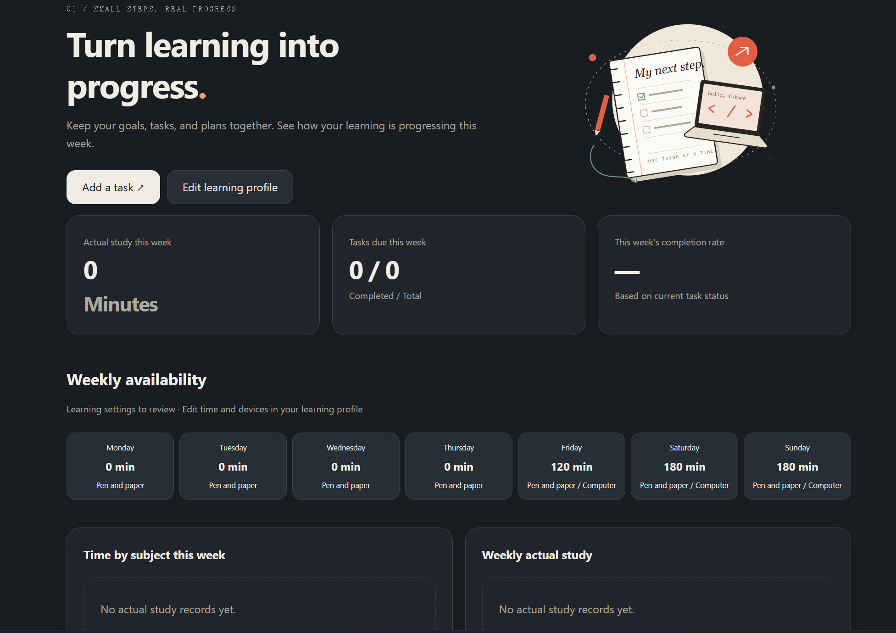

<div align="center">

# StudyPilot

### Turn learning into progress.

Plan a realistic study week, know your next task, and track the work you actually do.

**[Open the website](https://study-pilot-olive.vercel.app/) · [Download for Windows](https://github.com/aerixx0/Study_Pilot/releases/latest) · [AI setup](#ai-and-api-configuration)**

</div>



## Start here

### Open the website

Register or sign in on the hosted site, then choose English or Simplified Chinese. You can manage your study plan and use Chat from your browser. [Open StudyPilot](https://study-pilot-olive.vercel.app/)

### Install the Windows app (0.6.6)

1. Download **StudyPilot-Windows-x64-Setup.exe** and its SHA-256 checksum. Run the installer on Windows 10 or 11 (x64). Installation is per user and a desktop shortcut is optional. [Latest Windows release](https://github.com/aerixx0/Study_Pilot/releases/latest)
2. Open **StudyPilot** from the Start menu. The launcher starts the local service and opens your default browser. It listens on `127.0.0.1` and normally starts on port `8501`. If that port is busy, the launcher can use another port.
3. Sign in to your local account. For a fresh installation with data from a previous version, import the old account directory before signing in with your existing credentials. Local passwords must be 6–128 characters long.
4. Stop the service using the Start menu shortcut or `studypilot stop`. Uninstalling removes the app and keeps your learning data and backups by default.

The installer includes Python, dependencies, and SQLite. Installation and core study features work offline. Cloud AI requires an internet connection. [Connect cloud AI on Windows](#connect-cloud-ai-on-windows)

[Windows usage guide (Chinese)](Usage.md) · [Installer validation report (Chinese)](docs/WINDOWS_INSTALLER.md)

### Run the local app from source

Install Python 3.12 or later on Windows and run these commands from the repository root.

```powershell
cd python-ai-agent-ai-agent-studypilot/outputs/StudyPilot
py -3 -m venv .venv
.\.venv\Scripts\python.exe -m pip install -e ".[local]"
.\.venv\Scripts\studypilot.exe start
```

You can also double-click `Start-StudyPilot.cmd` in the application directory. The source and installed versions share the same user data directory by default. Set `STUDYPILOT_HOME` to isolate data and service state during development and testing.

### Windows CLI

| Command | What it does |
| --- | --- |
| `studypilot start` | Start the local service and open the browser. Use `--no-browser` to print the address or `--port PORT` to request a specific port. |
| `studypilot status` / `studypilot stop` | Show the current service address or stop the managed service. |
| `studypilot task list` / `studypilot plan preview` / `studypilot record list` | View your tasks, preview a weekly plan, or inspect study records after local sign-in. |
| `studypilot ai ask "Help me plan this week" --model qwen` | Ask an AI model after consent. Use `--model gpt-oss` for GPT-OSS or omit the option for automatic selection. |
| `studypilot ai status` / `studypilot ai configure` | Check on-device Qwen and directly configured Cloudflare credentials, or save a personal Cloudflare token interactively. Linked cloud access is managed in **Account → Cloud AI**. |
| `studypilot data path` / `studypilot data backup` | Show data locations or back up local accounts and learning data. |
| `studypilot --help` | List commands and options. Subcommands also accept `--help`. |

## What StudyPilot helps you do

| Your need | Current functionality |
| --- | --- |
| Know where to begin | The Web first-use checklist guides you through profile, tasks and plan confirmation, then shows the next saved session. |
| Plan around real life | Set a weekly budget, daily minutes, available devices, session length and an optional overall target deadline. |
| Make tasks manageable | Add due dates, estimates, priorities, notes, status and computer requirements. Edit tasks as your needs change. |
| Keep plans feasible | A rule-based scheduler checks daily/weekly/session limits and the earlier target/task deadline. Unscheduled work includes reasons and suggested adjustments. |
| See actual effort | Log time only after studying. Charts separate actual study time from estimates and planned sessions. |
| Get optional AI help | Discuss learning in Chat, Goal Coach or Plan Builder mode. Inspect proposed changes before deciding whether to apply them. |
| Control your account | Edit your display name, avatar and bio; change passwords; manage sessions; export your own learning data. |

Goals are optional. Reported subject levels break ties when priorities and device requirements are otherwise equal. Saved plans are snapshots. Regenerate and confirm a plan after changing tasks, availability, or study records.

## Real interface screenshots

Captured from the Web interface with a disposable demonstration account and explicitly entered test tasks.

<details>
<summary>Overview and the next confirmed study session</summary>


</details>

<details>
<summary>Weekly plan with time limits and confirmation</summary>


</details>

## AI and API configuration

In **Chat** on the hosted site, choose **Qwen**, **GPT-OSS**, or **Auto**. Auto tries Qwen first and can switch to GPT-OSS after an eligible provider failure. Both cloud models use Cloudflare Workers AI. A StudyPilot account is enough to use hosted AI.

| Model | Model ID | Where it runs |
| --- | --- | --- |
| [Qwen 3.8 27B](https://developers.cloudflare.com/workers-ai/models/qwen3.8-27b/) | `@cf/qwen/qwen3.8-27b` | Cloudflare Workers AI, on the web or through linked Windows access |
| [GPT-OSS 20B](https://developers.cloudflare.com/workers-ai/models/gpt-oss-20b/) | `@cf/openai/gpt-oss-20b` | Cloudflare Workers AI, on the web, through linked Windows access, or with your own Windows credentials |
| Qwen 3.5 4B | `qwen3.5:4b` | Optional on-device Windows inference via llama.cpp |

### Connect cloud AI on Windows

1. Sign in on the website and open **Account → Connect the Windows app → Generate connection code**.
2. In the Windows app, sign in to your local account and open **Account → Cloud AI**. Paste the code and select **Enable Cloud AI**.
3. Open **Chat** and try a model. The code works once within 10 minutes. The resulting desktop authorization lasts 30 days and can be revoked from the web account.

This connection lets the app call the cloud models. Your local and hosted accounts and learning records remain separate.

### Optional Windows model setup

- **On-device Qwen.** The installer omits the model weights and llama.cpp. To enable offline inference, place a compatible x64 `llama-server.exe` and its supporting files in `%LOCALAPPDATA%\StudyPilot\llama.cpp`, and place `Qwen3.5-4B-Q4_K_M.gguf` in `%LOCALAPPDATA%\StudyPilot\models`. Restart StudyPilot to start it on `127.0.0.1:11435`. If it is ready, selecting **Qwen** on Windows uses it first.
- **Personal Cloudflare credentials.** Run `studypilot ai configure` and enter your Cloudflare Account ID and Workers AI API Token in the interactive prompts. StudyPilot stores them in Windows Credential Manager. This enables direct GPT-OSS calls. Cloud Qwen on Windows uses the linked StudyPilot web account.

### Configure Cloudflare for a hosted deployment

1. In Cloudflare Workers AI, open **Use REST API**, create a Workers AI API token scoped to your account, and copy the 32-character Account ID. For a custom token, grant **Workers AI Read** and **Workers AI Edit** on that account. [Cloudflare REST API setup](https://developers.cloudflare.com/workers-ai/get-started/rest-api/)
2. In your Vercel project's **Production** environment, set `STUDYPILOT_SHARED_AI=1` and `CLOUDFLARE_ACCOUNT_ID`. Save `CLOUDFLARE_API_TOKEN` as a secret and keep the PostgreSQL connection configured. Redeploy for the settings to take effect.
3. Sign in to the deployed site and send a test message with each model selected. To verify Windows access, generate a connection code and try the models from the linked app. The developer view shows whether credentials are present. A successful chat verifies inference.

The released Windows app connects to the public StudyPilot site. To link Windows installs to your own server, change `RELAY_ORIGIN` in `studypilot/ai.py` and rebuild the installer for that server.

To test Cloudflare independently in PowerShell, first set `CLOUDFLARE_ACCOUNT_ID` and `CLOUDFLARE_API_TOKEN` in your current process. This sends a fixed test prompt to each model and prints its reply.

```powershell
$baseUrl = "https://api.cloudflare.com/client/v4/accounts/$env:CLOUDFLARE_ACCOUNT_ID/ai/v1"
foreach ($model in '@cf/qwen/qwen3.8-27b', '@cf/openai/gpt-oss-20b') {
    $body = @{
        model = $model
        messages = @(@{ role = 'user'; content = 'Reply with OK.' })
        max_tokens = 256
        reasoning_effort = 'low'
    } | ConvertTo-Json -Depth 4
    $reply = Invoke-RestMethod -Method Post -Uri "$baseUrl/chat/completions" `
        -Headers @{ Authorization = "Bearer $env:CLOUDFLARE_API_TOKEN" } `
        -ContentType 'application/json' -Body $body
    $reply.choices[0].message.content
}
```

StudyPilot's default limits are 15 requests per account per 10-minute window and 400 per hosted site per UTC day. Web and linked desktop requests share the hosted limits. Cloudflare applies its own daily allowance and billing rules. Workers Free currently includes 10,000 Neurons per day and stops requests when the allowance is exhausted. Workers Paid can bill for additional usage. [Cloudflare Workers AI pricing](https://developers.cloudflare.com/workers-ai/platform/pricing/)

### Consent and confirmation

Cloud requests include your prompt, conversation context, and relevant learning data only after you consent. AI can read relevant data and suggest changes. Applying a suggestion requires a separate confirmation and a valid, unexpired proposal. Proposals expire after 30 minutes. Refreshing the page or signing out clears the conversation and drafts. [Cloudflare Workers AI data policy](https://developers.cloudflare.com/workers-ai/platform/data-usage/)

## Technology and data

- **Web** uses FastAPI with HTML, CSS, and JavaScript.
- **Hosted storage** uses PostgreSQL with per-account learning schemas and persistent sessions, plans, proposals, and quotas.
- **Windows** starts a loopback-only Streamlit workspace. Opening the AI assistant loads the shared FastAPI conversation interface.
- **Local storage** uses SQLite under `%LOCALAPPDATA%\StudyPilot\data\accounts`. Backups default to the sibling `backups` directory under `%LOCALAPPDATA%\StudyPilot`.
- **Account and data protection** includes scrypt password hashes, recovery codes, HTTP-only session cookies, same-origin and CSRF checks, input validation, and versioned writes.

Web task and record forms use account-scoped `Idempotency-Key` receipts. A write and its receipt commit or roll back together. Clients retrying the same operation must reuse the same key.

Accounts on the same hosted instance can access their saved data after signing in from another browser. **Local installations and the hosted website have separate accounts and records, with no automatic synchronization.** Back up local account directories or use your PostgreSQL provider's backup facilities. Export excludes credentials; full-account import/restore is not currently available.

## Run the Web interface from source on Windows

Use Python 3.12+ and PowerShell. From a checkout or extracted source archive:

```powershell
cd python-ai-agent-ai-agent-studypilot/outputs/StudyPilot
python -m venv .venv
.\.venv\Scripts\python.exe -m pip install -r requirements.txt
$env:STUDYPILOT_WEB_LOCAL = '1'
.\.venv\Scripts\python.exe -m uvicorn studypilot.web:app --host 127.0.0.1 --port 8510
```

Open [the local Web interface](http://127.0.0.1:8510/) to test FastAPI with SQLite. This runs the Web interface directly. Use `studypilot start` to test the normal Windows launcher and desktop handoff.

### Environment variables

Set variables in the process or hosting platform. StudyPilot reads the process environment. [.env.example](python-ai-agent-ai-agent-studypilot/outputs/StudyPilot/.env.example) lists the supported setup without secrets.

| Variable | Requirement |
| --- | --- |
| `DATABASE_URL` or `POSTGRES_URL` | Required for deployed Web PostgreSQL storage. |
| `STUDYPILOT_SHARED_AI=1` | Enables Qwen and GPT-OSS on the hosted site and enables the Windows cloud AI connection endpoints. |
| `CLOUDFLARE_ACCOUNT_ID`, `CLOUDFLARE_API_TOKEN` | Required together for shared cloud AI. The token stays in the server's secret configuration. |
| `STUDYPILOT_WEB_LOCAL=1` | Enables explicit local Web SQLite mode outside Vercel. |
| `STUDYPILOT_AUTH_DIR` | Optional local account-directory override. |
| `STUDYPILOT_HOME` | Optional Windows data, logs, and service state directory. |
| `STUDYPILOT_AI_ENABLED` | Set to `0` to disable AI calls. The default is `1`. |
| `STUDYPILOT_AI_USER_LIMIT` | Defaults to 15 requests per account per window. |
| `STUDYPILOT_AI_WINDOW_SECONDS` | Defaults to 600 seconds. |
| `STUDYPILOT_AI_SITE_LIMIT` | Defaults to 400 requests per UTC day, persisted server-side. |

Never commit API keys, connection strings, account data or runtime folders.

## Deployment and source layout

Set the Vercel Root Directory to `python-ai-agent-ai-agent-studypilot/outputs/StudyPilot`. The FastAPI entry point is `studypilot.web:app` in `pyproject.toml`, and the deployed Python version is defined in `.python-version`. Set a production PostgreSQL connection and keep test data in a separate database. [Deployment guide (Chinese)](python-ai-agent-ai-agent-studypilot/outputs/StudyPilot/DEPLOYMENT.md)

For deployment checks, start with `GET /api/health` and confirm that `database_configured` is true. This checks configuration presence. Sign in separately to verify the database and try both models to verify AI. `POST /api/agent` serves signed-in Chat requests with a session, CSRF token, and consent. The `/api/desktop-ai/` routes issue and exchange one-time codes and accept inference requests with a desktop-only bearer token.

Within the application directory:

| Path | Responsibility |
| --- | --- |
| `public/` | Web UI, language catalogues, theme and navigation motion. |
| `studypilot/web.py`, `auth.py` | HTTP routes, account/session checks and confirmation boundaries. |
| `models.py`, `scheduler.py`, `progress.py` under `studypilot/` | Validated inputs, constrained planning and actual-study statistics. |
| `database.py`, `postgres.py` under `studypilot/` | Local/hosted persistence, transactions and retry receipts. |
| `ai.py`, `agent.py`, `agent_tools.py`, `proposals.py` under `studypilot/` | Fixed providers, bounded tool loop, read tools and reviewed changes. |
| `relay.py`, `quota.py` under `studypilot/` | Desktop cloud authorization and persistent AI quotas. |
| `tests/` | Functional, UI, model-mock and optional PostgreSQL integration tests. |
| `app.py`, `studypilot/cli.py` | Local Streamlit workspace and Windows CLI. |

## Tests and release verification

From the application directory:

```powershell
.\.venv\Scripts\python.exe -m pip install -r requirements-dev.txt
.\.venv\Scripts\python.exe -m unittest discover -s tests -v
.\.venv\Scripts\python.exe -m compileall -q studypilot app.py
```

Optional browser-helper checks require Node.js 22+:

```powershell
node tests/test_workflow.cjs
node --check public/study.js
```

Automated tests mock model responses. PostgreSQL cases run when `STUDYPILOT_TEST_POSTGRES` points to a separate localhost test database. GitHub Actions runs the Python tests, compilation checks, and JavaScript checks. The 0.6.6 release was also verified on Windows and with live cloud calls through the web and desktop relay. [GitHub Actions](https://github.com/aerixx0/Study_Pilot/actions) · [Windows 0.6.6 validation report (Chinese)](docs/WINDOWS_INSTALLER.md)

Build the offline installer on Windows with Python 3.12+ and Inno Setup 6.7.3.

```powershell
python scripts/build_windows_installer.py --iscc 'C:\Path\To\ISCC.exe'
```

The builder verifies the embedded CPython archive and packages pinned Windows wheels and local app files. For installer prerequisites and verification see [Windows installer notes](docs/WINDOWS_INSTALLER.md). The older source ZIP builder remains available for source releases.

## Known limits and roadmap

- The local installer targets Windows 10 and 11 on x64. The local Streamlit workspace is in Simplified Chinese, and the shared conversation interface supports English and Simplified Chinese. The installer currently has no Authenticode signature.
- Plans have day-level sessions, not exact calendar start/end times. They do not automatically rebuild after a missed day or changed inputs.
- Actual study time is not proof of mastery. Tasks currently have three statuses and notes, without structured partial completion or plan undo.
- Changing language does not translate existing user writing. Chat/drafts do not survive refresh; local and hosted installations do not synchronize.
- **Next:** clearer task actions/completion criteria and reviewed rescheduling. **Later:** simple knowledge checks and review rules. These roadmap items are not implemented features.

## Contributing and license

Open a focused [issue](https://github.com/aerixx0/Study_Pilot/issues) or pull request with reproduction steps and tests for changed business behavior. Use disposable accounts and mocked models. Include no private learning data or credentials.

Keep the root README and GitHub release notes in English. [Repository guidance](AGENTS.md)

The project code uses the [MIT License](python-ai-agent-ai-agent-studypilot/outputs/StudyPilot/LICENSE). Third-party models and services have their own terms.
