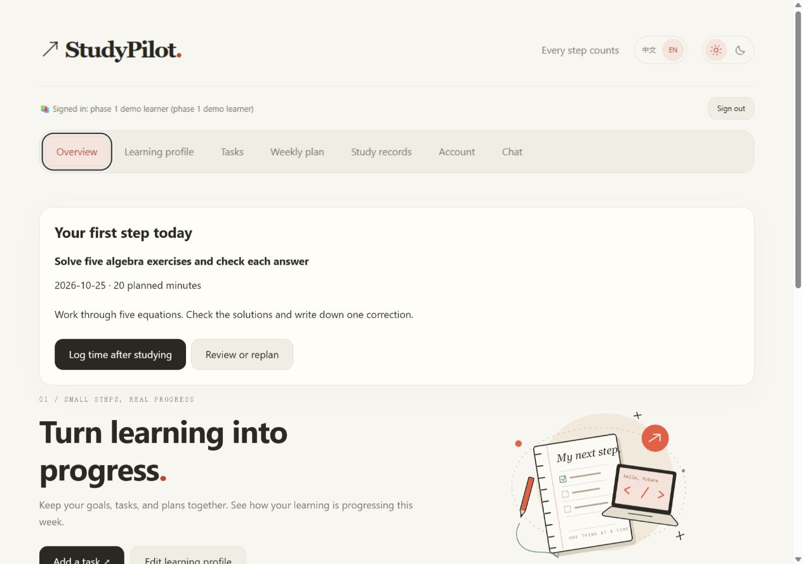
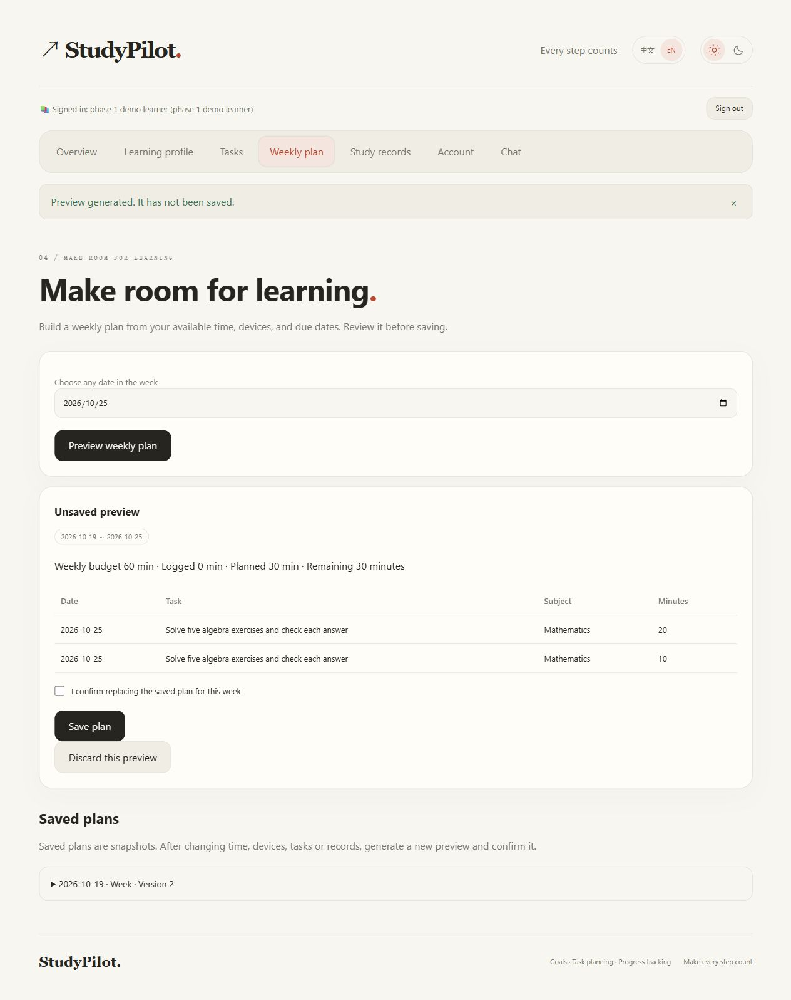

<div align="center">

# StudyPilot

### Turn learning into progress.

Plan a realistic study week, know your next task, and track the work you actually do.

**[Open the website](https://study-pilot-olive.vercel.app/) · [Windows installation and usage](Usage.md)**

</div>


## Start here

### Open the website

**[https://study-pilot-olive.vercel.app/](https://study-pilot-olive.vercel.app/)**

No installation is required. Register an account and choose English or Simplified Chinese.

### Install the Windows app (0.6.6)

1. Double-click **StudyPilot-Windows-x64-Setup.exe** and follow the setup wizard. The installer supports per-user installation on Windows 10 and 11 (x64). A desktop shortcut is optional.
2. Open **StudyPilot** from the Start menu. The local app opens in your default browser when it is ready. If you have an account from a previous installation, import your old data first and sign in with your existing password. Local passwords must be at least six characters long.
3. Use the StudyPilot stop shortcut in the Start menu to stop the service. You can uninstall the app from Windows Settings and keep your study data.

The installer includes Python, dependencies, and SQLite for offline installation. StudyPilot stores local data in `%LOCALAPPDATA%\StudyPilot` by default. Get the installer and its SHA-256 checksum from [GitHub Releases](https://github.com/aerixx0/Study_Pilot/releases/tag/v0.6.6).

[Installation, CLI, backups, and legacy data import](Usage.md) · [Changes, testing, and known limitations](docs/WINDOWS_INSTALLER.md)

### Run the local app from source

Install Python 3.12 or later on Windows and run these commands from the repository root.

```powershell
cd python-ai-agent-ai-agent-studypilot/outputs/StudyPilot
py -3 -m venv .venv
.\.venv\Scripts\python.exe -m pip install -e ".[local]"
.\.venv\Scripts\studypilot.exe start
```

You can also double-click `Start-StudyPilot.cmd` in the application directory. Common CLI commands are `studypilot start`, `studypilot status`, `studypilot stop`, and `studypilot --help`. The source and installed versions share the same user data directory by default. Set `STUDYPILOT_HOME` to isolate data and service state during development and testing.

## What StudyPilot helps you do

| Your need | Current functionality |
| --- | --- |
| Know where to begin | The Web first-use checklist guides you through profile, tasks and plan confirmation, then shows the next saved session. |
| Plan around real life | Set a weekly budget, daily minutes, available devices, session length and an optional overall target deadline. |
| Make tasks manageable | Add due dates, estimates, priorities, notes, status and computer requirements. Edit tasks as your needs change. |
| Keep plans feasible | A rule-based scheduler checks daily/weekly/session limits and the earlier target/task deadline. Unscheduled work includes reasons and suggested adjustments. |
| See actual effort | Log time only after studying. Charts separate actual study time from estimates and planned sessions. |
| Get optional AI help | Discuss learning in Chat, Goal Coach or Plan Builder mode. Inspect proposed changes before deciding whether to apply them. |
| Control your account | Edit your display name, avatar and bio; change passwords; manage sessions; export your own learning data. |

Goals may remain blank, and saving changes requires confirmation. Lower reported subject levels break otherwise equal priority/device ties; they do not create a mastery score or inflate your estimates. Saved plans are snapshots: regenerate and confirm after changing tasks, availability or records.

## Real interface screenshots

Captured from the Web interface with a disposable demonstration account and explicitly entered test tasks.

<details>
<summary>Overview: the next confirmed study session</summary>



</details>

<details>
<summary>Weekly plan: budget, bounded sessions and explicit confirmation</summary>



</details>

## AI configuration and confirmation

Core learning management and rule-based scheduling work without a model key. To enable AI, configure at least one key **on the server**:

| Provider | Fixed model | Environment variable |
| --- | --- | --- |
| Zhipu, primary | `glm-4.7-flash` | `ZHIPU_API_KEY` |
| Cloudflare Workers AI, preferred fallback | `@cf/zai-org/glm-4.7-flash` | `CLOUDFLARE_ACCOUNT_ID` **and** `CLOUDFLARE_API_TOKEN` |
| SiliconFlow, legacy fallback | `XingChenAGI/Xing4.0-29B` | `SILICONFLOW_API_KEY` |

The adapter uses `/chat/completions` at fixed, allowlisted addresses. Eligible rate limits, timeouts, network failures and server errors may trigger the configured fallback. It never silently selects an unlisted paid model. Provider access, availability, pricing and commercial terms follow provider policies; a published app does not prove live model access.

Each conversation selects **at most the first two fully configured providers** in the order above, including all tool rounds. Missing Cloudflare credentials leave the existing Zhipu/SiliconFlow route intact. Cloudflare runs its own hosted model; it does not call the Zhipu API. Keep Cloudflare on **Workers Free**: its current allocation is 10,000 Neurons/day, with calls stopped at the limit. A Workers Paid account can incur overage charges for the same model. StudyPilot cannot enforce your external account's billing plan. [Cloudflare setup and troubleshooting](docs/CLOUDFLARE_AI.md).

The developer-only maintenance screen shows configuration status and links to Cloudflare and Vercel settings. It never returns token values. Configuration status means credentials are present, not that a live model request has succeeded.

The workflow is **read → propose → review → explicitly confirm → validate and apply**. AI cannot directly execute protected changes or provide arbitrary schedules for storage. The server validates ownership, schemas, versions and confirmation; proposals expire after 30 minutes. Execution receipts prevent duplicate application. Generating a new plan preview clears the old confirmation; discarding it leaves the saved plan intact.

Questions, conversation context and relevant learning data are sent to the configured providers only after consent. Account credentials are excluded. Failed requests retain the question for retry in the open tab. Chat and drafts clear on refresh/sign-out.

Cloudflare is an overseas service. Its [Workers AI data policy](https://developers.cloudflare.com/workers-ai/platform/data-usage/) states that customer content is not used for model training; standard inference retention has limited exceptions, and enabled logging or stateful features may retain content. Include this provider in your own privacy disclosures before serving users.

## Technology and data

- **Web:** FastAPI with native HTML, CSS and JavaScript; no React, Next.js or frontend build step.
- **Hosted storage:** PostgreSQL with per-account learning schemas and persistent sessions, plans, proposals and quotas.
- **Local storage:** SQLite account databases under the application's `data/accounts/` directory.
- **Local Windows interface:** Streamlit, launched by the installed shortcut or `studypilot start`.
- **Protection:** scrypt password hashes, recovery codes, HTTP-only cookies, same-origin/CSRF checks, input validation and versioned writes.

Web task/record forms use account-scoped `Idempotency-Key` receipts for retries; a write and its receipt commit or roll back together. Clients must reuse the same key for the same operation. A new action after refresh is not automatically treated as an old retry.

Accounts on the same hosted instance can access their saved data after signing in from another browser. **Local installations and the hosted website have separate accounts and records, with no automatic synchronization.** Back up local account directories or use your PostgreSQL provider's backup facilities. Export excludes credentials; full-account import/restore is not currently available.

## Run the Web interface from source on Windows

Use Python 3.12+ and PowerShell. From a checkout or extracted source archive:

```powershell
cd python-ai-agent-ai-agent-studypilot/outputs/StudyPilot
python -m venv .venv
.\.venv\Scripts\python.exe -m pip install -r requirements.txt
$env:STUDYPILOT_WEB_LOCAL = '1'
.\.venv\Scripts\python.exe -m uvicorn studypilot.web:app --host 127.0.0.1 --port 8510
```

Open **[http://127.0.0.1:8510/](http://127.0.0.1:8510/)** for the English/Chinese Web interface with local SQLite. The Windows installer's normal launcher opens the separate Chinese Streamlit interface, starting at port 8501.

### Environment variables

StudyPilot does not automatically load `.env` files. Set variables in the process or hosting platform; [.env.example](python-ai-agent-ai-agent-studypilot/outputs/StudyPilot/.env.example) contains names only.

| Variable | Requirement |
| --- | --- |
| `DATABASE_URL` or `POSTGRES_URL` | Required for deployed Web PostgreSQL storage. |
| `STUDYPILOT_WEB_LOCAL=1` | Required for explicit local Web SQLite mode; disabled on Vercel. |
| `STUDYPILOT_AUTH_DIR` | Optional local account-directory override. |
| `ZHIPU_API_KEY`, `SILICONFLOW_API_KEY` | Optional; at least one is needed for AI calls. |
| `CLOUDFLARE_ACCOUNT_ID`, `CLOUDFLARE_API_TOKEN` | Optional pair enabling Cloudflare Workers AI; an alternative to the keys above. |
| `STUDYPILOT_AI_ENABLED` | Optional; set to `0` to pause model calls. |
| `STUDYPILOT_AI_USER_LIMIT` | Optional; default 15 requests per account per window. |
| `STUDYPILOT_AI_WINDOW_SECONDS` | Optional; default 600 seconds. |
| `STUDYPILOT_AI_SITE_LIMIT` | Optional; default 400 requests per UTC day, persisted server-side. |

Never commit API keys, connection strings, account data or runtime folders.

## Deployment and source layout

Vercel Root Directory: **`python-ai-agent-ai-agent-studypilot/outputs/StudyPilot`**. The entry point is **`studypilot.web:app`**, configured in `pyproject.toml`; dependencies are in `requirements.txt`. Production requires PostgreSQL and does not fall back to temporary SQLite. Use separate production and test databases. See the [deployment guide (Chinese)](python-ai-agent-ai-agent-studypilot/outputs/StudyPilot/DEPLOYMENT.md).

Within the application directory:

| Path | Responsibility |
| --- | --- |
| `public/` | Web UI, language catalogues, theme and navigation motion. |
| `studypilot/web.py`, `auth.py` | HTTP routes, account/session checks and confirmation boundaries. |
| `models.py`, `scheduler.py`, `progress.py` under `studypilot/` | Validated inputs, constrained planning and actual-study statistics. |
| `database.py`, `postgres.py` under `studypilot/` | Local/hosted persistence, transactions and retry receipts. |
| `ai.py`, `agent.py`, `agent_tools.py`, `proposals.py` under `studypilot/` | Fixed providers, bounded tool loop, read tools and reviewed changes. |
| `tests/` | Functional, UI, model-mock and optional PostgreSQL integration tests. |
| `app.py` | Separate local Streamlit interface. |

## Tests and release verification

From the application directory:

```powershell
.\.venv\Scripts\python.exe -m pip install -r requirements-dev.txt
.\.venv\Scripts\python.exe -m unittest discover -s tests -v
.\.venv\Scripts\python.exe -m compileall -q studypilot app.py
```

Optional browser-helper checks require Node.js 22+:

```powershell
node tests/test_workflow.cjs
node --check public/study.js
```

Models are mocked in automated tests. PostgreSQL cases run only when `STUDYPILOT_TEST_POSTGRES` points at an independent localhost test database; otherwise they skip. CI runs Python tests/compilation and JavaScript checks. There is no configured bundler or separate type-check command. [Audit](docs/PHASE0_AUDIT.md) · [Phase 1 report](docs/PHASE1_REPORT.md) · [This release's validation](docs/RELEASE_PREVIEW_2.md).

Build the offline installer on Windows with Python 3.12+ and Inno Setup 6.7.3.

```powershell
python scripts/build_windows_installer.py --iscc 'C:\Path\To\ISCC.exe'
```

The builder verifies the embedded CPython archive and packages pinned Windows wheels and local app files. For installer prerequisites and verification see [Windows installer notes](docs/WINDOWS_INSTALLER.md). The older source ZIP builder remains available for source releases.

## Known limits and roadmap

- The local installer targets 64-bit Windows 10/11. The bundled Streamlit interface is in Simplified Chinese. The installer currently has no Authenticode signature.
- Plans have day-level sessions, not exact calendar start/end times. They do not automatically rebuild after a missed day or changed inputs.
- Actual study time is not proof of mastery. Tasks currently have three statuses and notes, without structured partial completion or plan undo.
- Changing language does not translate existing user writing. Chat/drafts do not survive refresh; local and hosted installations do not synchronize.
- **Next:** clearer task actions/completion criteria and reviewed rescheduling. **Later:** simple knowledge checks and review rules. These roadmap items are not implemented features.

## Contributing and license

Open a focused [issue](https://github.com/aerixx0/Study_Pilot/issues) or pull request with reproduction steps and tests for changed business behavior. Use disposable accounts and mocked models. Include no private learning data or credentials.

The project code uses the [MIT License](python-ai-agent-ai-agent-studypilot/outputs/StudyPilot/LICENSE). Third-party models and services have their own terms.
